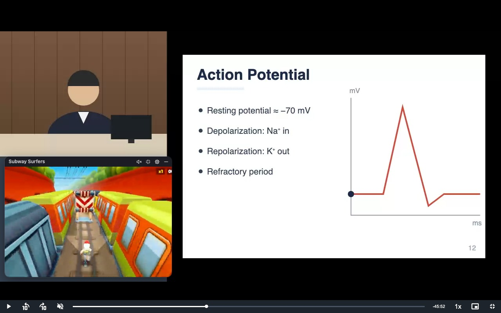

# FlickWaySurfer

Subway Surfers gameplay in a floating window beside your [Flick](https://flick.docchula.com) lectures. Move it, resize it, hide it, and it stays on screen when the lecture goes full screen.

> **Unofficial fan project.** Not affiliated with Docchula or Flick, or with SYBO, the makers of Subway Surfers. The gameplay plays through YouTube's own embedded player ([this video](https://www.youtube.com/watch?v=lGlFs6lEcoU)), so no video is bundled here.

## Install

1. Download this repository (**Code → Download ZIP**) and unzip it.
2. Go to `chrome://extensions` and turn on **Developer mode** (top right).
3. Click **Load unpacked** and select the unzipped folder.
4. Open a lecture on Flick. If Flick was already open, refresh it.

## Use

| To | Do this |
|---|---|
| Move | Drag the title bar |
| Resize | Drag any edge or corner |
| Hide / show | The `–` button on the title bar, the toolbar button, or **Alt+Shift+S** (⌥⇧S on a Mac). Hidden, it folds into a small orange tab on the side of the screen: click the tab to bring it back |
| Reset | Double-click the title bar to put the window back where it started |
| Another video | The gear on the title bar: paste any YouTube link and press **Play this video**. **Back to Subway Surfers** returns to the default. Your choice is saved, so it's still there next time |
| Sound | It starts muted. The speaker button turns the sound on, at a low volume |
| Fill / Fit | Crop the video to fill the window, or show all of it |

**Full screen.** The window stays on top of the lecture in full screen. Until you move it there, it sits over the bottom half of the lecture's left third, under the lecturer's camera and clear of the slides, on any screen size. Once you move or resize it in full screen, it remembers that spot, separately from the one on the page. The toolbar is hidden in full screen, so use the `–` button, the orange tab or the shortcut. To change the shortcut, go to `chrome://extensions/shortcuts`.

The video loops forever. It plays only while a lecture is on screen and the window is showing, and pauses when you hide it, leave the lecture, or switch tabs.

## Files

| File | Role |
|---|---|
| `manifest.json` | Manifest V3. Runs on `flick.docchula.com` only, and asks for `storage` and nothing else |
| `content/surfer.js` | The floating window: placement, drag and resize, full screen, the YouTube embed and its video settings |
| `background/service-worker.js` | The toolbar button and the keyboard shortcut |
| `icons/` | `icon.svg` (the source) and the PNG sizes Chrome uses |
| `build.sh` | Builds the Chrome Web Store zip |
| `store_assets/` | Store graphics, and `LISTING.md` with every text field the store asks for |
| `PRIVACY.md` | The privacy policy the store listing links to |

There's no build step for development. After editing, click the reload icon on the extension's card in `chrome://extensions`, then refresh Flick.

## Publishing

1. Raise `version` in `manifest.json`.
2. Run `./build.sh`. It writes `dist/` and `flickwaysurfer-<version>.zip`, holding only the files the extension uses.
3. Upload the zip in the [Chrome Web Store Developer Dashboard](https://chrome.google.com/webstore/devconsole). [`store_assets/LISTING.md`](store_assets/LISTING.md) has the text and graphics for each field.

## Privacy

The extension stores the window's size, position and visibility, and the YouTube video you chose, in `chrome.storage.local`, and nothing else. It makes no network requests of its own. The only thing loaded from outside is YouTube's embedded player, from `youtube-nocookie.com`. See [PRIVACY.md](PRIVACY.md).
